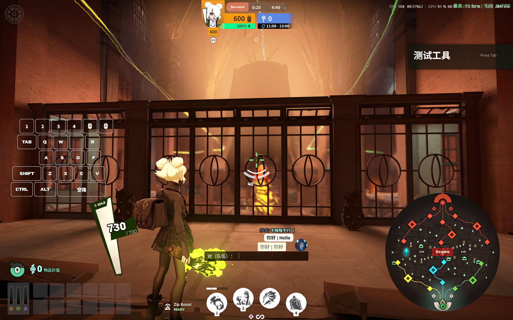
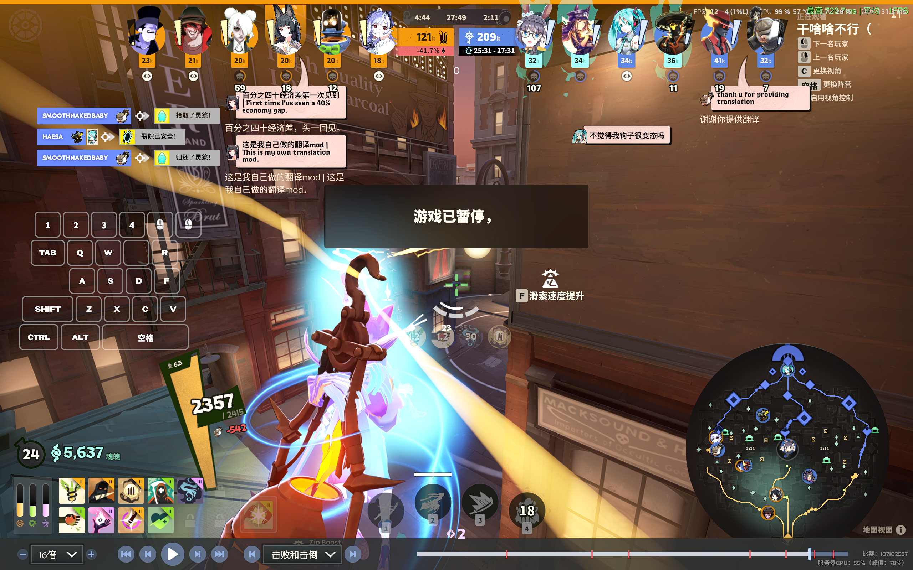

# 同频 · Deadlock 聊天翻译

**Deadlock翻译（死锁翻译）**：面向 Windows 的 Deadlock Chat Translator，支持游戏聊天翻译、队伍/全体双语发送和死锁术语适配。

技术结构：Panorama 游戏界面＋本地 .NET 后台＋TypeScript 设置页。翻译调用云端服务，本地不运行翻译模型。

当前源码版本 **0.5.0**。非 Valve 官方项目，与 Valve 无隶属或背书关系。

翻译服务推荐、费用参考和模型 ID 填写要求见[使用说明](docs/USER-GUIDE.md)。

## 游戏内效果

作者提供的实际游戏截图：双语发送与聊天气泡译文。截图包含其他已安装的外观/UI Mod，其英雄头像等效果不是本翻译 Mod 提供的功能；截图中的帧率也不是本项目性能测试结果。

## 直接下载安装

**[下载 Windows x64 完整运行包](https://github.com/jinganwushideng/deadlock-translate/releases/download/v0.5.0/DeadlockTranslate-0.5.0-win-x64.zip)** · [全部版本与校验文件](https://github.com/jinganwushideng/deadlock-translate/releases)

无需编译或另外安装 .NET。请下载 `DeadlockTranslate-0.5.0-win-x64.zip`，不要把 GitHub 自动提供的 `Source code` 当作运行程序。

1. 解压整个文件夹到固定位置，先退出 Deadlock，再运行 `Install.cmd`。
2. 首次使用 HTTPS 时运行 `Trust-Local-Https.cmd`，核对本机证书并确认信任，然后完整退出并重启 Steam。已有 0.4.2 且 HTTPS 正常的用户无需重复安装证书。
3. 运行 `Settings.cmd`，配置自己的翻译服务和 API Key；包内没有附赠 API 额度。
4. 运行 `Launch.cmd`；若平时从 Steam 启动，请按包内 `Steam-Launch-Options.txt` 配置启动选项。

不要只取出 EXE：VPK、配对文件、网页和词库必须保持配套。已有旧版时先按使用说明卸载旧 Mod，保留个人配置后再安装新版。完整步骤见包内“使用说明-先读我.txt”。

## 功能

- 聊天记录和顶部聊天气泡追加中文译文，支持所有玩家消息及自身消息开关。
- 快译、精翻、先快后精；Bing 网页通道、Azure Translator、Chat Completions 兼容接口。
- 死锁术语及英俄常用简称适配，可编辑、导入和导出词库。
- 左 Alt＋空格提交翻译发送，支持英文或原文＋英文、队伍和全体频道。
- 快译与精翻分别排队，共享服务并发上限；发送按频道保持顺序。
- Steam 启动选项联动后台，无需常驻监视程序或开机自启。
- 游戏内设置窗口及浏览器设置入口，密钥使用当前 Windows 用户的 DPAPI 保存。

0.5.0 新增发送预留名额、精翻请求合并/缓存、双语回显复用和连接自检。首次使用 HTTPS 需按使用说明信任本机证书并重启 Steam。

## 使用与开发

- [详细使用说明](docs/USER-GUIDE.md)：安装、启动选项、API 配置、快捷键及卸载。
- [从源码构建](docs/BUILDING.md)：工具、资源生成和打包。
- [来源与许可证范围](THIRD-PARTY-NOTICES.md)、[来源核对记录](docs/SOURCE-AUDIT.md)。
- [验证范围](docs/VALIDATION.md)、[发布到 GitHub](docs/PUBLISHING.md)。
- [参与贡献](CONTRIBUTING.md)、[隐私与安全](SECURITY.md)。

源码目录：`src/Bridge` 后台，`src/Settings` 设置页，`mod` Panorama 脚本与样式，`scripts` 构建安装工具，`tests` 测试。

## 当前限制

游戏更新可能改变 Panorama 控件和接口。自动化模拟测试不代表游戏实测通过；聊天发送、输入焦点、游戏内 HTML 点击、不同分辨率显示仍需在当前游戏版本中验证。高并发不能消除服务商限流或网络延迟，也不构成 FPS 保证。

Bing 网页通道不是稳定性有保障的正式 API，失效时不会静默改用付费服务。聊天内容会发送给你配置的翻译服务；精翻可能携带最近 6 条、60 秒内的上下文。不要把个人密钥或完整状态目录提交到仓库。

## 授权

本项目可授权的代码和文档使用 **GPL-3.0-only**，见 [LICENSE](LICENSE)。保留第三方署名，详见 [NOTICE](NOTICE)。主要游戏接入参考 BabelTower，Steam 启动方式参考 SteamWrap。

Valve 游戏资源不受本项目许可证授权：公开源码不包含反编译的原版聊天布局、生成的游戏本地化词库、游戏图标或工具二进制；构建时从使用者自己的游戏安装生成所需资源。
